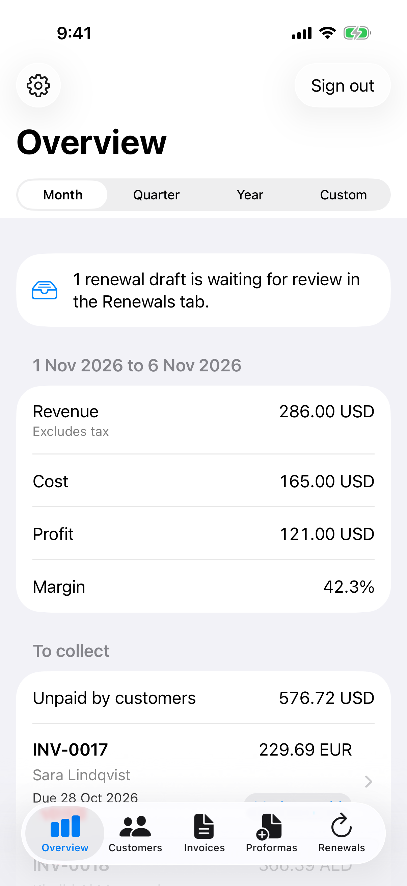
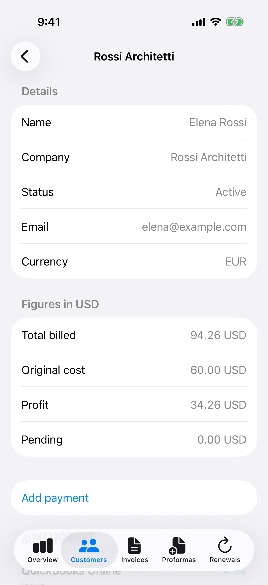
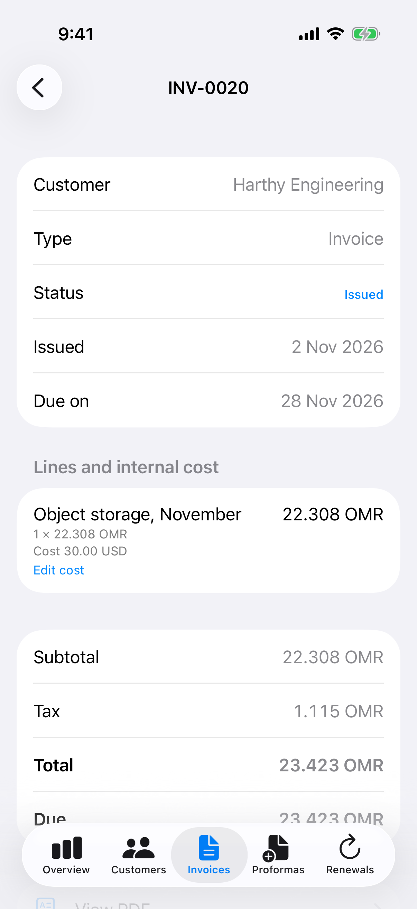
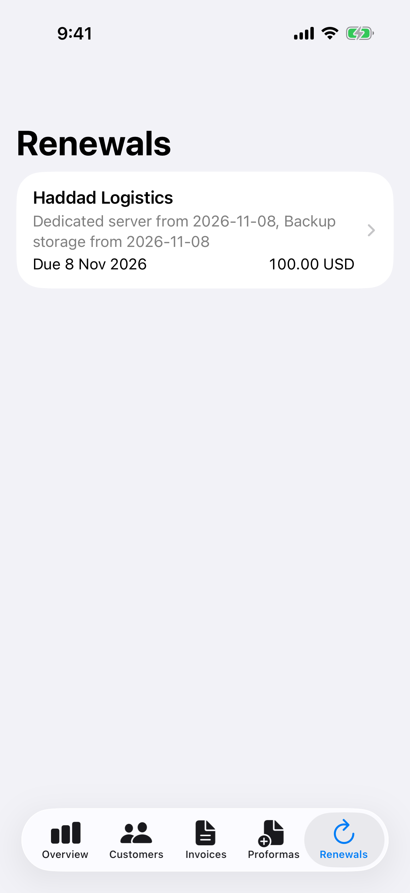

<p align="center"></p>

<h1 align="center">Octax Solobill for iOS</h1>

<p align="center">
  <strong>Your billing, in your pocket.</strong><br>
  See what's unpaid, mark invoices paid, review renewals and scan provider bills, from your iPhone.
</p>

<p align="center">
  <a href="https://inv.octax.dev"><strong>Free at inv.octax.dev</strong></a>
  ·
  <a href="https://github.com/octax-app/solobill">Server and web app</a>
</p>

<p align="center">
  <a href="https://github.com/octax-app/solobill-ios/actions/workflows/ci.yml"></a>
  
  
  <a href="LICENSE"></a>
</p>

<p align="center">
  
  
  
  
</p>

This is the iPhone companion to [Octax Solobill](https://github.com/octax-app/solobill), billing for
solo traders who resell services. It talks to the same API as the web app, so everything stays in
sync.

## Features

- **Overview.** Revenue, cost, profit and margin for any period, invoices to collect, provider bills
  to pay, and profit by month.
- **Customers.** Each customer's billing, cost, profit and subscriptions. Record a payment and it is
  spread over their oldest invoices.
- **Invoices and proformas.** Create, edit, issue, void, reverse to draft and duplicate. Open the PDF
  and share it.
- **Payments.** Mark paid, record partial payments and discounts, or undo them.
- **Renewals.** Review the drafts made for upcoming renewals and issue them in a tap.
- **Provider bills.** Scan a paper bill with the camera, or share a PDF to Solobill from Mail or Files.
- **Reminders.** Push notifications for renewals and unpaid bills.
- **Private by default.** Face ID locks the app, and the sign-in token lives only in the Keychain.
- **Sign in** with email, Apple or Google, with optional two-step login and in-app account deletion.

No third-party dependencies. All invoice maths happens on the server, so the app never rounds money
itself.

## Getting started

You need Xcode 26 and [XcodeGen](https://github.com/yonaskolb/XcodeGen) (`brew install xcodegen`).
The Xcode project is generated from `project.yml` and not committed.

```sh
git clone https://github.com/octax-app/solobill-ios.git && cd solobill-ios
xcodegen generate
open Solobill.xcodeproj
```

Run it on a simulator with no extra setup. Debug builds talk to `http://localhost:3000`, and the
login screen has a field to change that. Release builds use `https://inv.octax.dev`, or whatever
`API_BASE_URL` you set in `project.yml`.

### A local server with demo data

Clone the [web repo](https://github.com/octax-app/solobill) next to this one and run `pnpm install`
in it. Then:

```sh
scripts/dev-server.sh 3100
```

That starts a throwaway server with demo data on an empty temporary database. Log in with
`owner@example.com` and `demo-password`. Set `SOLOBILL_WEB` if the web repo is somewhere else.

### Running on your own device

Device builds need your Apple Developer Team ID. Put it in `Local.xcconfig`, which is not committed:

```sh
echo 'DEVELOPMENT_TEAM = ABCDE12345' > Local.xcconfig
xcodegen generate
```

To ship your own copy, also change the bundle id `dev.octax.mg` and the app group
`group.dev.octax.mg` in `project.yml` and the code, and set `API_BASE_URL` to your server. The app
target needs **Sign in with Apple** and **Associated Domains** on its App ID. The server's
[self-hosting guide](https://github.com/octax-app/solobill/blob/main/docs/SELF_HOSTING.md) covers push
notifications and sign-in. Command line device builds need `-allowProvisioningUpdates`.

## Tests

```sh
xcodebuild test -project Solobill.xcodeproj -scheme Solobill \
  -destination 'platform=iOS Simulator,name=iPhone 17' -only-testing:SolobillTests

TEST_RUNNER_TEST_SERVER_URL=http://localhost:3100 xcodebuild test -project Solobill.xcodeproj \
  -scheme Solobill -destination 'platform=iOS Simulator,name=iPhone 17' -only-testing:SolobillUITests
```

The UI tests need the local server. They launch with `-serverURL`, `-skipAppLock` and
`-skipPushPrompt`, which only exist in Debug builds.

`CaptureUITests` also needs `TEST_RUNNER_TEST_APP_GROUP_PATH`, set to the output of
`xcrun simctl get_app_container <simulator> dev.octax.mg group.dev.octax.mg` after the app has been
installed on that simulator once. The demo data has two renewal drafts, and some `RenewalsUITests`
use one up, so run those on a fresh server.

`ScreenshotTests` regenerates the screenshots above. It only runs when
`TEST_RUNNER_SCREENSHOT_DIR` is set.

## Layout

| Path | What lives there |
|---|---|
| `Solobill/App` | App entry, tabs, lock screen |
| `Solobill/Core/API` | `APIClient`, and `Endpoints.swift` with one typed call per route |
| `Solobill/Core/Auth` | Keychain token store, `Session`, Apple and Google sign-in |
| `Solobill/Core/Formatting` | `Money` and `ISODay` |
| `Solobill/Models` | Types that follow the server's `openapi.json` |
| `Solobill/Shared` | `Loadable`, `PDFScreen`, `MarkPaidSheet`, `PaymentSheet`, `reloadsOnReturn` |
| `Solobill/Features` | One folder per screen |
| `SolobillShare` | Share extension that receives PDFs from other apps |
| `Branding` | The app mark. `scripts/make-icons.sh` turns it into every icon |

## Rules

- Screens load through `Loadable`, which gives every screen its spinner, error and Retry.
- All invoice maths stays on the server. `Money` only formats values and parses typed text, using
  integers. Never use `Double` for an amount.
- The token lives only in the Keychain. Do not copy it into memory, defaults or logs.
- Files are reached only through `api.file(key:)` and `api.invoicePDF(id:)`.
- No third-party dependencies.

## Changing the API

The API is defined in the web repo. After changing its response types, run these there, then update
`Models.swift` here:

```sh
pnpm openapi
pnpm ios:fixtures   # writes this repo's SolobillTests/Fixtures
```

`DecodingTests` decodes those real responses, and the server's contract test fails if the schemas and
the server disagree.

## Licence

[MIT](LICENSE). Octax Solobill is part of the Octax family of apps.
